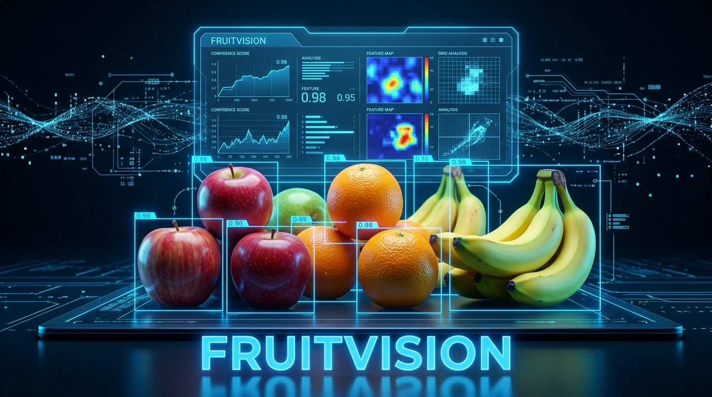

# FruitVision — interface integrada



Interface React/TypeScript para o [FruitVision Backend YOLO11](https://github.com/WalyRobert/FruitVision-Backend-YOLO11). Envia imagens e vídeos somente após ação do usuário, desenha caixas/polígonos retornados e baixa o MP4 processado. A chave do backend fica no gateway Node, fora do JavaScript público.

## Executar

Requer Node.js 22 e o backend Python em execução em http://127.0.0.1:8000. Siga o README do backend para instalação, modo demo e pesos YOLO opcionais.

```bash
npm ci
```

Copie `.env.example` para `.env`. Ajuste `FRUITVISION_BACKEND_URL` e, se exigida no backend, `FRUITVISION_API_KEY`. Não use prefixo VITE para credenciais.

```bash
npm run build
npm start
```

Abra http://127.0.0.1:3001 e clique em **Verificar backend**. Para desenvolvimento, use `npm run server` e `npm run dev -- --host 127.0.0.1` em terminais separados; Vite encaminha `/api` ao gateway.

## Fluxo e limites

- PNG/JPEG/WebP: até 5 MB e 12 milhões de pixels. Prévia local; detectar ou segmentar envia o arquivo ao backend configurado.
- MP4/WebM/AVI/MOV: até 25 MB; o backend verifica duração de até 30 segundos e 300 frames, codec e pixels. Vídeos podem ser recusados por codec indisponível.
- Download por até 1 hora; MP4 `mp4v`, sem áudio. A reprodução em navegadores pode exigir transcodificação.
- Cancelar interrompe a espera do navegador; não garante interromper uma inferência já iniciada no servidor.
- Um processamento por gateway; retorno 429 se ocupado. Não há porcentagem de progresso inventada.

**Demo não faz inferência:** retorna listas vazias, sem comprovar ausência de frutas. YOLO real exige pesos locais compatíveis, configurados no backend; faltando pesos, a operação retorna erro. Segmentação é 2D. A soma de detecções de vídeo é por frame e não conta frutas únicas. Não há SAM 3D, ObjectCounter ou classificação de qualidade. A precisão dos modelos e o desempenho em GPU não foram validados nesta entrega.

## Verificar

```bash
npm test
npm run test:server
npm run build
```

Os testes validam contratos, modo demo, arquivos, origem, encaminhamento autenticado e download. Não usam serviço de IA pago ou pesos reais. O gateway escuta apenas loopback; para acesso público, implemente autenticação de usuários, limites de recursos e proxy TLS. `FRUITVISION_BACKEND_URL` é configuração confiável do administrador, nunca entrada da interface; redirecionamentos são recusados.

Autor: Waly Robert. As dependências possuem licenças próprias; este repositório não concede licença adicional automaticamente.


## Início e diagnóstico simplificados

Após `npm ci`, execute `npm run diagnostico` para verificar Node, dependências, build e presença de configuração sem revelar chaves ou consumir cota. Execute `npm run iniciar` para compilar a versão atual e abrir o servidor local em um único terminal. A faixa de estado da interface distingue configuração ausente e integração ainda não comprovada. Encontrar uma chave não confirma que ela é válida nem que existe cota gratuita. Nenhum teste de geração é iniciado automaticamente.

